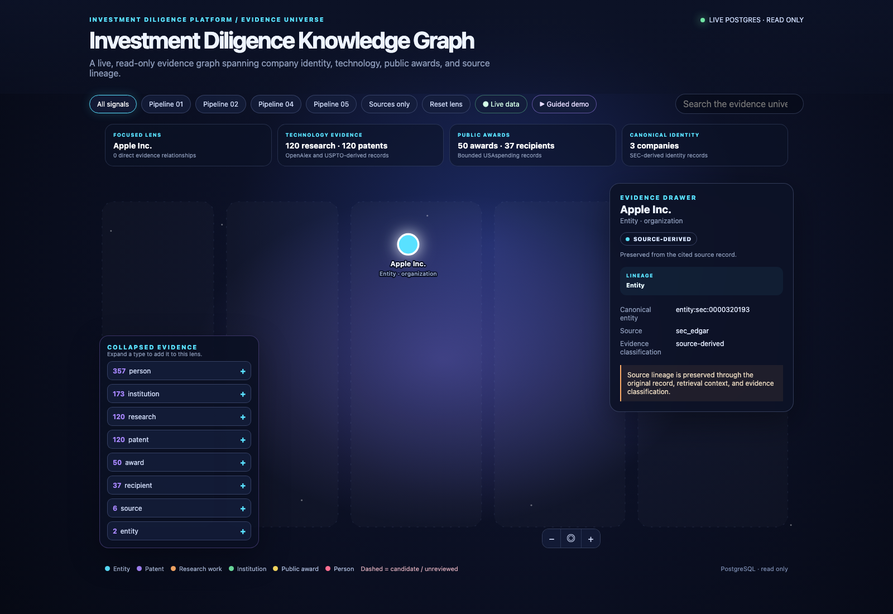
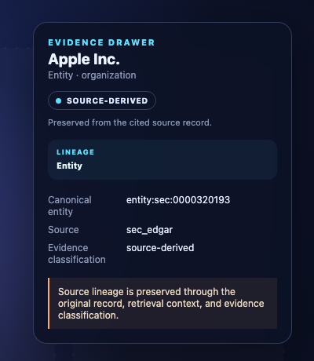

# Demo 01 — AI, cyber & mission software

This two-minute guided view starts with a bounded 2024 Department of Defense award slice and focuses the graph on the public-award evidence that supports it. Open **Guided demo** in the live graph, choose **Scenario 01**, then use the focused neighborhood to move from the award to the reported recipient and source record without implying that a public award establishes technical capability, performance, or a corporate relationship beyond what the evidence says.

The presenter should lead with the insight cards, then open the evidence drawer to show a human-readable source, status, and lineage. This makes the AI/cyber narrative compelling precisely because it remains source-bounded: the demo distinguishes verified or source-derived public records from candidates and inference, while leaving unsupported conclusions visibly unsupported.

