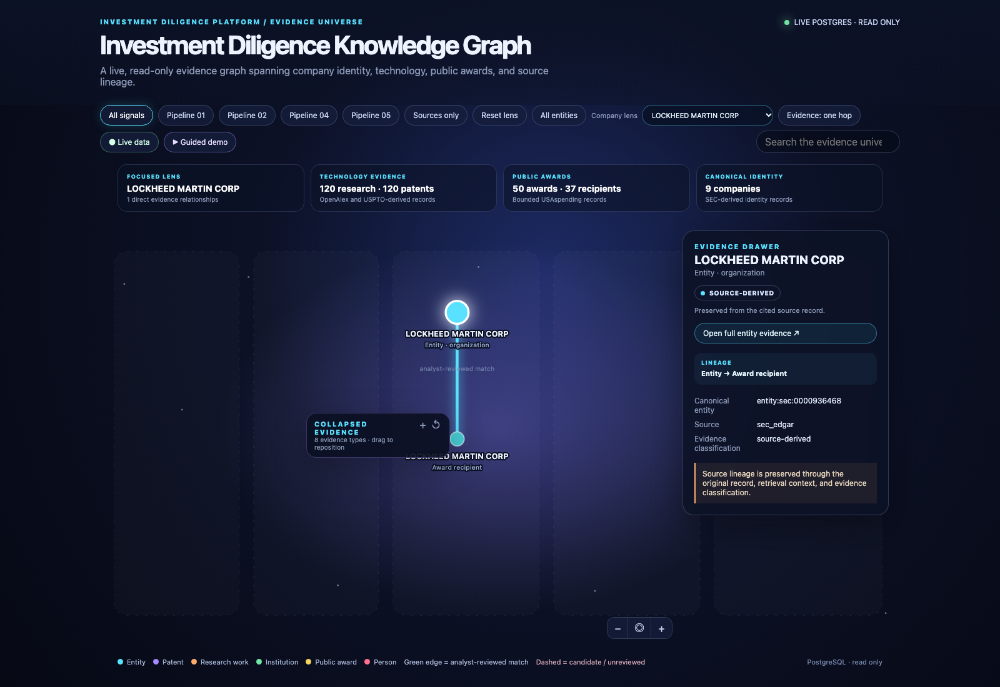
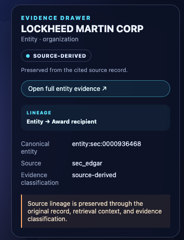

# Demo 02 — Lockheed Martin: reviewed public-award evidence

This company-led demo opens on **Lockheed Martin Corp.** because one USAspending recipient record was explicitly approved against the SEC issuer identity. The green edge is an analyst-reviewed mapping from the SEC company to the reported recipient; it is not evidence of contract performance, payment, revenue, product capability, ownership of every similarly named recipient, or a broader corporate conclusion.

Open **Full entity evidence** to inspect the company-bounded path: Lockheed Martin → reviewed recipient → public award → USAspending source. The drawer intentionally stops at shared sources and other hubs, so the presenter can show all evidence for this entity without accidentally sweeping in the wider award universe.

